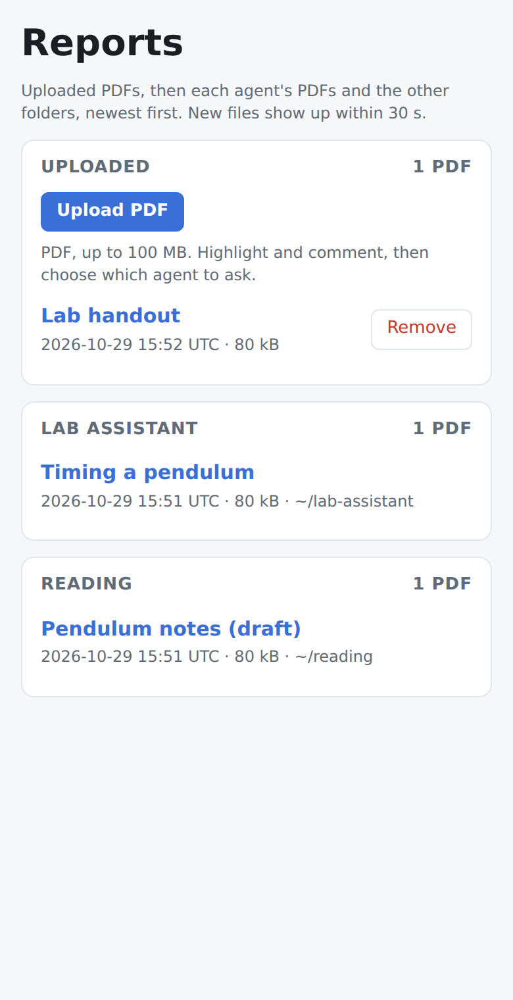
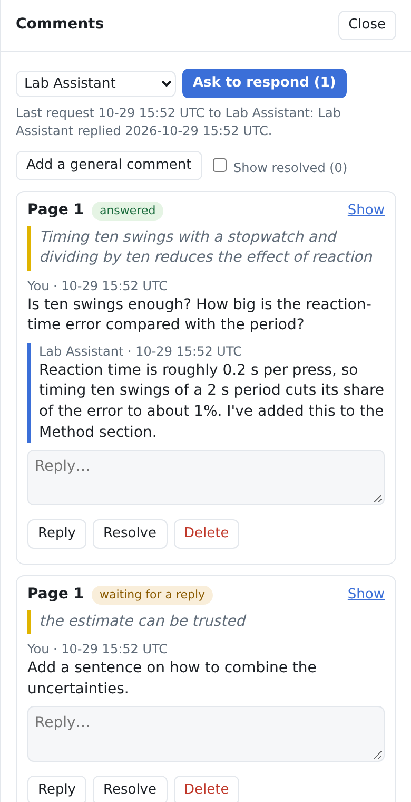
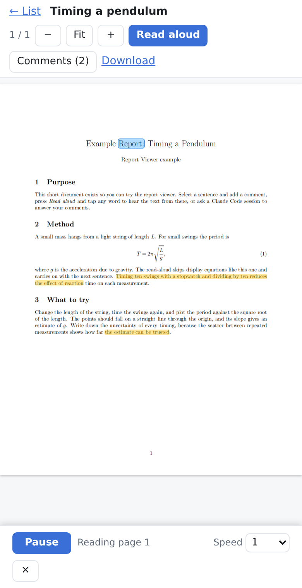

# Report viewer

A small local web page for reading PDFs on a phone or computer. It can:

- List the PDFs in folders you choose, newest first.
- Let you **upload** a PDF (up to 100 MB).
- Open each one in a viewer (Mozilla PDF.js) that works on a phone.
- Let you **highlight text and comment** on it. You can reply, resolve and delete comments.
- **Read it aloud**, highlighting each word as it is spoken. This runs locally on the CPU with Piper TTS.
- **Ask a Claude Code session to answer your comments.** The session is woken up, reads the comments and replies,
  and the replies appear on the page.

It's one Python file (`report_viewer.py`, standard library only, Python 3.9 or newer) plus the bundled PDF.js.
Read-aloud has its own small install.

<p>
  
  
  
</p>

## Quick start

```bash
git clone https://github.com/ProcterThomas/report-viewer.git
cd report-viewer
python3 report_viewer.py docs                         # try it on the example PDF
python3 report_viewer.py ~/papers "Drafts=~/thesis/drafts"   # your own folders
```

Open http://127.0.0.1:8090/ in a browser on the same computer.

- Each folder becomes a section on the page. It's searched recursively, skipping hidden folders.
- `LABEL=FOLDER` names a section; otherwise the section takes the folder's name.
- Ctrl-C stops the server.

Your comments, uploads and the list of agents are kept in `~/.report-viewer`. To keep them somewhere else, use
`--data DIR` or set `REPORT_VIEWER_DATA`. The viewer never changes, moves or deletes the PDFs in your folders.

## Read-aloud (optional)

```bash
./setup-readaloud.sh
```

This needs an internet connection once, and installs into `readaloud/` only:

- a Python environment `readaloud/.venv` (it uses `uv` if you have it), with `piper-tts` and `pymupdf` (~300 MB);
- the `en_US-lessac-medium` voice (~60 MB), checked against the sha256 sums in `readaloud/requirements-service.txt`.

Then restart the viewer and press **Read aloud** on any PDF:

- Tap a word to start reading from there, or press Play to start at the current page.
- The speed menu changes the playback speed.
- The speech service starts on first use and stops itself after 15 idle minutes.

The exact package versions were tested with Python 3.14. On another Python, the script falls back to
`piper-tts==1.8.0` with current versions of the rest.

## Asking Claude Code to answer comments

Each Claude Code session that should answer comments is an "agent" on the page. It needs two things.

**1. Register each session.** Run this inside the session, for example by asking Claude to run it:

```bash
python3 /path/to/report-viewer/report_viewer.py agent register "Thesis helper" --folder ~/thesis/out
```

- The session gets its own section on the page, listing the PDFs in `--folder` (the default is the current folder).
- It also becomes a choice in the **Ask to respond** menu.
- Registering again with the same name replaces the old entry. `agent unregister` removes it, and `agent list` shows
  all agents.

**2. Install the wake-up hook, once per computer.**

```bash
python3 /path/to/report-viewer/report_viewer.py agent hook-config
```

- This prints the `SessionStart` and `Stop` hooks for `~/.claude/settings.json`. Merge them in, keeping any hooks that
  are already there, then restart your Claude sessions.
- The hook runs in the background. It does nothing for sessions that aren't registered.

**Using it:**

1. Comment on a PDF, open **Comments**, choose the agent (a PDF in an agent's own section has that agent preselected)
   and press **Ask to respond**.
2. Within a few seconds the session wakes up with a short notice. The notice doesn't contain your comment text: the
   session reads the comments itself:

   ```bash
   python3 report_viewer.py comments                     # comments waiting for this session
   python3 report_viewer.py comments show <doc-id>       # every thread on one PDF
   python3 report_viewer.py comments reply <doc-id>/<thread-id> "the answer"     # "-" reads the text from stdin
   ```

3. The replies appear in the comment panel. The page refreshes it every 20 s.

If the session isn't running, the request stays queued, and the page shows a message you can paste into the chat
instead.

## Using it from your phone or another computer

By default the viewer only answers on `127.0.0.1`, this computer. There are three ways to reach it from elsewhere.

- **SSH tunnel:** `ssh -L 8090:127.0.0.1:8090 yourcomputer`, then open http://127.0.0.1:8090/ on the device you
  connected from.
- **Tailscale or another reverse proxy:** proxy to `127.0.0.1:8090`, and start the viewer with
  `--allow-host your-name.tailnet.ts.net` so it accepts that host name.
- **Directly on your network:** set a password, then use `--host`. The browser will ask for the password; any user
  name works.

  ```bash
  REPORT_VIEWER_PASSWORD='something long' python3 report_viewer.py --host 0.0.0.0 ~/papers
  ```

  Plain HTTP doesn't encrypt the password, so only do this on a network you trust. Without a password the viewer
  refuses to listen on the network, unless you pass `--no-auth`.

## Safety notes

- Every change (comment, upload, remove, ask) needs a per-run token from the page and a matching `Origin`. When the
  viewer listens on 127.0.0.1, it also only answers to the expected host names.
- Uploads must start like a PDF. They're stored under a cleaned-up name and never overwrite an existing file.
  **Remove** moves a file into `uploads/.deleted/` instead of deleting it.
- The viewer serves only PDFs it found in your folders, never a path taken from a request. The read-aloud service
  listens on 127.0.0.1 only and may read only those folders.
- Anyone who can open the page can also wake your registered Claude sessions. They're only asked to read and answer
  comments, but keep the page private.

## Platforms

- **Linux:** everything is tested, including read-aloud.
- **macOS:** the tests run on macOS in CI. Read-aloud setup should work (it uses `shasum` when `sha256sum` is
  missing) but hasn't been tried there yet.
- **Windows:** not tested. Reading, comments and uploads should work. The agent wake-up needs `fcntl`, which Windows
  doesn't have, and `setup-readaloud.sh` is a bash script, so use WSL for those.

## What's in the folder

| Path | What it is |
|---|---|
| `report_viewer.py` | The server, the `agent` and `comments` commands, and the wake-up hook. |
| `pdfjs/` | Mozilla PDF.js 6.4.299 (Apache-2.0, see `pdfjs/LICENSE` and `pdfjs/SOURCE.txt`). `cd pdfjs && sha256sum -c SHA256SUMS` checks it. |
| `readaloud/` | The read-along speech service (`readalong_server.py`, `pdf_align.py`, `units.py`) and its pinned requirements. |
| `setup-readaloud.sh` | Installs read-aloud (see above). |
| `tests/` | End-to-end tests (standard library only). |
| `docs/` | An example PDF with its LaTeX source, and the screenshots above. |

## Tests

```bash
python3 -m unittest discover -s tests -v
```

They start the server on a free port with temporary folders, and cover the PDF list, uploads, comments, asking an
agent, the wake-up hook, and the token, origin, host and password checks. The read-aloud test runs only after
`setup-readaloud.sh`. GitHub Actions runs them on Linux and macOS with Python 3.9 and 3.13.

## Licence

MIT, see [LICENSE](LICENSE). `pdfjs/` is Mozilla PDF.js 6.4.299 (Apache-2.0) with its bundled components, each
under the licence files in that folder.

`setup-readaloud.sh` downloads the third-party pieces read-aloud uses rather than bundling them: Piper TTS
(`piper-tts`, GPL-3.0-or-later), PyMuPDF (AGPL-3.0, or a commercial licence from Artifex) and the Piper voice.
Check the voice's model card for its terms. If you distribute read-aloud together with those packages, their
licences apply to that bundle.
